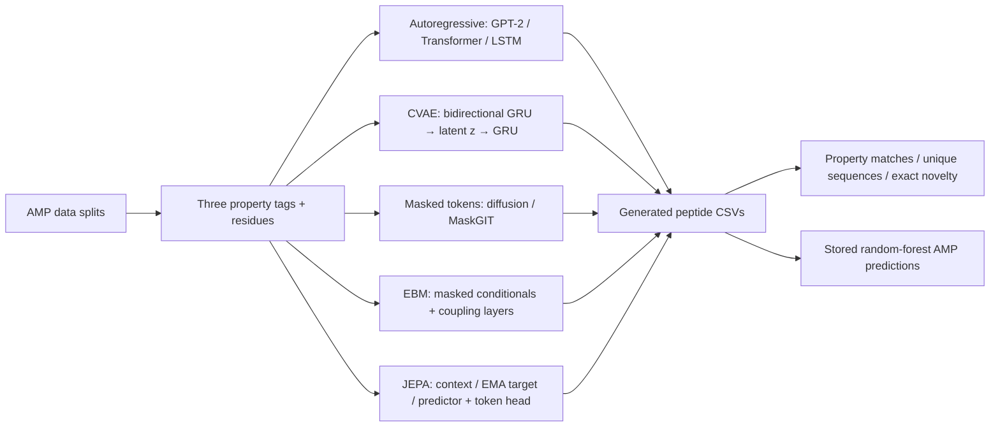
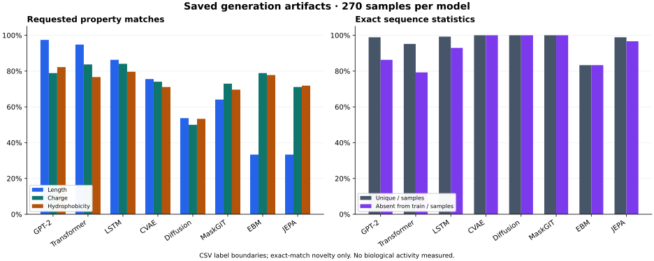

# PeptideForge

**Conditional peptide generation across eight neural architectures.** A research codebase exploring how autoregressive, latent-variable, masked-token, energy-based, and representation-prediction objectives generate ordered amino-acid sequences under length, charge, and hydrophobicity constraints.

The repository contains model implementations, seven generator checkpoints, 2,160 saved generated sequences, and evaluation notebooks. The aim is to compare controllability, repetition, and sequence-level novelty while making the evidence and its limits inspectable. No biological activity or best-model claim is established by these artifacts.

[Research and data](docs/RESEARCH.md) · [Experiments and results](docs/EXPERIMENTS.md) · [Setup and reproducibility](docs/REPRODUCIBILITY.md)

## Research question and data

How do different generation objectives balance requested physicochemical properties with diversity and exact-match novelty in peptide space?

The generator data contain **23,791 training / 2,974 validation / 2,974 test** AMP-labelled sequences, each 10–50 residues long. Separate scorer splits contain **129,556 / 16,195 / 16,195** positive and negative sequences. Exact sequence overlap between splits is zero within each task; homology-based separation was not verified. Upstream dataset attribution and split-construction provenance remain incomplete; see the [data audit](docs/RESEARCH.md#data-and-provenance).

Core training records have three property tags, a peptide, and `<EOS>`. The richer CSV labels implement:

| Constraint | Implemented proxy | Observed dataset bins |
|---|---|---|
| Length | Residue count | Short ≤20; medium 21–35; long ≥36 |
| Charge | `K + R − D − E` residue counts | Low ≤1; medium 2–4; high ≥5 |
| Hydrophobicity | Mean Kyte–Doolittle value | Low <−1; medium [−1,1); high ≥1 |

These are requested properties, not hard guarantees. Existing notebooks/demo use different length/charge boundaries, and some samplers use length hints inconsistent with dataset bins. The [research notes](docs/RESEARCH.md#conditional-constraints) explain both conventions. Current loaders also consume the first line of each headerless core file as a header, reducing the effective training/validation counts by one.

## Architecture and experiment pipeline



Training, generation, and evaluation are separate scripts/artifacts. Only GPT-2 starts from pretrained language-model weights; the separate peptide Transformer initializes its weights from scratch. The [experiment map](docs/EXPERIMENTS.md#pipeline-and-artifact-map) distinguishes implementations, checkpoint configs, shell wrappers, and saved evidence.

## Implemented models

All eight have training and generation code and 270 saved sequences each. Checkpoint availability refers to the current checkout.

| Model | Architecture / objective | Train | Generate | Checkpoint |
|---|---|---|---|---|
| GPT-2 | Pretrained `gpt2` fine-tuning; next-token loss on spaced residues | [train](generator/gpt2/train.py) | [generate](generator/gpt2/generate.py) | Absent |
| Transformer | Scratch causal decoder; amino-acid tokens, learned positions | [train](generator/transformers/train_transformer.py) | [generate](generator/transformers/generate_transformer.py) | [best.pt](models/generator/transformers/best.pt) |
| LSTM | Conditioned recurrent next-token model | [train](generator/lstm/train_lstm.py) | [generate](generator/lstm/generate_lstm.py) | [best.pt](models/generator/lstm/best.pt) |
| CVAE | Bidirectional GRU encoder, Gaussian latent, GRU decoder; reconstruction + KL | [train](generator/vae/train_vae.py) | [generate](generator/vae/generate_vae.py) | [best.pt](models/generator/vae/best.pt) |
| Diffusion | Discrete absorbing-mask diffusion; timestep-conditioned Transformer | [train](generator/diffusion/train_diffusion.py) | [generate](generator/diffusion/generate_diffusion.py) | [best.pt](models/generator/diffusion/best.pt) |
| MaskGIT | Bidirectional masked-token Transformer; iterative confidence decoding | [train](generator/maskgit/train_maskgit.py) | [generate](generator/maskgit/generate_maskgit.py) | [best.pt](models/generator/maskgit/best.pt) |
| EBM | Pseudo-likelihood Transformer + pairwise coupling; Gibbs/annealed sampling | [train](generator/energy/train_ebm.py) | [generate](generator/energy/generate_ebm.py) | [best.pt](models/generator/energy/best.pt) |
| JEPA | Context/EMA-target encoders, latent predictor, token head; latent + token losses | [train](generator/jepa/train_jepa.py) | [generate](generator/jepa/generate_jepa.py) | [best.pt](models/generator/jepa/best.pt) |

## Results from saved artifacts

Each model's [generation CSV](logs/) contains **27 tag combinations × 10 samples**. Every saved sample is a nonempty string of standard amino acids. Counts below include repeated samples; novelty means absence by exact sequence match from the full rich AMP training set.

| Model | Unique / 270 | Absent from train / 270 | Stored classifier positives / 270 | Mean stored P(AMP) |
|---|---:|---:|---:|---:|
| GPT-2 | 267 | 233 | 204 | 0.739290 |
| Transformer | 257 | 214 | 226 | 0.810664 |
| LSTM | 268 | 251 | 210 | 0.744801 |
| CVAE | 270 | 270 | 189 | 0.660698 |
| Diffusion | 270 | 270 | 196 | 0.674343 |
| MaskGIT | 270 | 270 | 217 | 0.729839 |
| EBM | 225 | 225 | 267 | 0.901681 |
| JEPA | 267 | 261 | 255 | 0.872934 |

**Provenance:** unique/novel counts are recomputed from the generation CSVs and `train_generator_amp_only.csv`; classifier counts and means summarize [scores_all_models.pkl](logs/scores_all_models.pkl). They are historical predictions, not fresh scorer inference or biological hit rates. Exact exports, definitions, and source hashes are in [generated_metrics.csv](docs/assets/generated_metrics.csv), [stored_score_metrics.csv](docs/assets/stored_score_metrics.csv), and [audit.json](docs/assets/audit.json).



The figure uses dataset label boundaries and original generation rows. Notebooks use conflicting bins and, for repeated sequences, a tag merge that can lose the requested condition. See [the full count table and caveats](docs/EXPERIMENTS.md#recoverable-sample-statistics). Higher stored classifier acceptance can coexist with repetition or weak length adherence; no overall ranking is inferred.

The [run summary](logs/summary.txt) marks all eight methods `OK`; that demonstrates reported execution, not comparative quality. Historical random-forest validation metrics are recoverable from a [versioned notebook](docs/EXPERIMENTS.md#historical-scorer-validation). Verified generator loss curves, multi-seed estimates, and biological measurements are missing; the [experiment record template](docs/EXPERIMENTS.md#notebook-caveats-and-missing-results) identifies what future runs should capture.

## Verified generated examples

These are the **first saved data rows**, not selected high-scoring candidates. Each requests `<LEN_SHORT> <CHARGE_LOW> <HYDRO_LOW>`. Properties are recomputed using the repository's proxies; hydrophobicity is rounded here.

| Source | Saved peptide | Length | Charge proxy | Mean hydrophobicity |
|---|---|---:|---:|---:|
| [GPT-2 CSV](logs/generation_gpt_2.csv) | `QKYYEQLEQAFIRD` | 14 | −1 | −1.364286 |
| [Transformer CSV](logs/generation_transformer.csv) | `DGQPNIQQKETRK` | 13 | 1 | −2.423077 |
| [CVAE CSV](logs/generation_cvae.csv) | `SDTVRIPCNPDRDCYEY` | 17 | −2 | −1.182353 |

No antimicrobial activity has been experimentally verified for these generated examples.

## Quickstart

Run from the repository root. Inspect the saved experiments without installing ML packages:

```bash
python3 scripts/research_report.py --help
python3 scripts/research_report.py --output-dir /tmp/peptideforge-audit
```

For a minimal CPU generation environment, use Python 3.14 and `uv`:

```bash
uv venv --python 3.14 .venv-cpu
uv --no-config pip install --python .venv-cpu/bin/python torch==2.10.0 --index-url https://download.pytorch.org/whl/cpu
uv --no-config pip install --python .venv-cpu/bin/python numpy==2.4.3 pandas==3.0.1 matplotlib==3.10.8
source .venv-cpu/bin/activate
OMP_NUM_THREADS=1 MKL_NUM_THREADS=1 python generator/lstm/generate_lstm.py \
  --model_path models/generator/lstm/best.pt \
  --length_tag '<LEN_MED>' --charge_tag '<CHARGE_MED>' --hydro_tag '<HYDRO_MED>' --n 1
```

This prints one stochastic sample using a tracked checkpoint. The installation and all seven checkpoint generation commands passed CPU smoke tests on Linux x86_64 with these versions; see the [validation record](docs/REPRODUCIBILITY.md#validation-record). Installation requires network access and compatible wheels. Full training is GPU-recommended and was not run. Original training hardware and memory requirements are not recorded.

Use the [reproducibility guide](docs/REPRODUCIBILITY.md) for other models, figure regeneration, and future training commands. The preserved lockfile targets ROCm; plain project synchronization is not the portable CPU path above. GPT-2 weights and the random-forest `.joblib` file are missing, so GPT-2 inference, fresh AMP scoring, and the Marimo demo require additional assets.

## Repository guide

| Path | Purpose |
|---|---|
| [generator/](generator/) | Eight model implementations and train/generate CLIs |
| [data/](data/) | Preserved generator/scorer splits and text exports |
| [models/](models/) | Seven generator checkpoints and scorer metadata |
| [logs/](logs/) | Saved samples, score archive, execution summary |
| [metrics_notebook.ipynb](metrics_notebook.ipynb) | Historical evaluation outputs; execution-order caveats |
| [evaluation_notebook.ipynb](evaluation_notebook.ipynb) | Mostly unexecuted visualization scaffold with handwritten example metrics |
| [demo.py](demo.py) | Marimo interface; missing scorer/GPT-2 assets limit execution |
| [scripts/research_report.py](scripts/research_report.py) | Read-only artifact audit and derived reports/figure |

## Limits and acknowledgements

These experiments have incomplete dataset provenance and run metadata, conflicting evaluation conventions, unseeded sampling, and no recovered multi-run uncertainty estimates. The scorer shares conditioning proxies and is not a substitute for biological validation. Exact sequence novelty does not imply homology novelty. Existing source data, model code, notebooks, checkpoints, and saved results are preserved.

The approaches draw on GPT-2, Transformer, CVAE, discrete diffusion, MaskGIT, and JEPA research; [references and rights notes](docs/RESEARCH.md#references-and-rights) link the original work. No repository LICENSE file was found, and upstream dataset licensing is unresolved. This presentation adds no new license claims.
